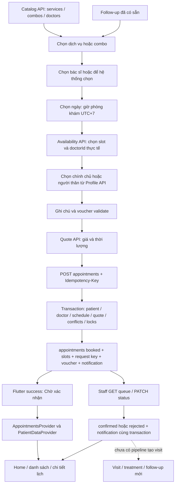

# Audit toàn bộ quy trình đặt lịch — MediCare Dental

Ngày audit: 31/10/2026 (Asia/Ho_Chi_Minh). Nguồn: code thực tế trong workspace tại thời điểm đọc.

## 1. Phạm vi và kết luận

**Chưa đủ bằng chứng chốt READY cho demo API thật ngày 03/11/2026.** Luồng bệnh nhân và backend có nền tảng tốt, toàn bộ baseline test được tái hiện; vẫn có lỗi/rủi ro về voucher bất đồng bộ, công cụ demo staff và khoảng trống liên kết hồ sơ khám.

- AUDIT ONLY: không sửa code/cấu hình/test; chỉ tạo báo cáo này.
- Không chạy lệnh Git; không kiểm tra hay suy đoán workspace trùng bản mới nhất GitHub. Nội dung remote mới hơn, nếu có, nằm ngoài audit.
- Không đọc `.env`, `serviceAccountKey.json`, private key hay giá trị token; không chạy server/seed/set-staff/API ghi Firebase thật. Các tham chiếu header trong code không được sử dụng để gọi Firebase.
- Test backend khởi động Express trên loopback với Firebase đã được thay bằng fake trước khi nạp route. Flutter dùng MockClient/fixture.
- PASS LOCAL = bằng chứng test local vừa chạy; CODE = xác minh bằng đọc code; PARTIAL = chỉ hoàn thành một phần; NOT VERIFIED = chưa có bằng chứng tương ứng. Không có PASS Firebase thật trong báo cáo.

| Hạng mục | Kết luận | Căn cứ/giới hạn |
|---|---|---|
| Booking UI | PARTIAL; chưa chốt READY | Luồng chính có đủ màn; còn race voucher và trải nghiệm xử lý slot cũ |
| Booking API | PASS LOCAL; Firebase NOT VERIFIED | Transaction, ownership, key, voucher, trạng thái được test fake |
| Staff confirmation | PARTIAL | API + công cụ HTTP có; chưa tìm thấy UI staff trong `frontend/lib`; request demo A01-7 sai liên kết ID |
| Booking → Notification/Home | PASS LOCAL; Firebase NOT VERIFIED | Ghi notification cùng transaction; Flutter refresh và điều hướng có test |
| Booking → Records/Follow-up | PARTIAL | Lịch xuất hiện ở tab Hồ sơ; follow-up mở booking được; chưa có pipeline tạo visit/follow-up từ completed |
| Demo API thật 03/11 | Chưa đủ điều kiện nghiệm thu | Cần xử lý các mục P1 và chạy checklist sandbox bên dưới |

## 2. Sơ đồ luồng thực tế

Lưu ý: khi chọn “hệ thống chọn”, availability trả slot có doctorId; Flutter gửi doctorId cụ thể đó trong POST. Backend có nhánh tự phân bác sĩ khi không gửi doctorId, nhưng UI này thường đã chọn bác sĩ thực tế trước khi submit.

## 3. Mapping Flutter → Provider → Service → Backend → Firestore

Các đường dẫn trong bảng đều tính từ gốc repository. Số dòng tham chiếu là lúc audit, có thể dịch chuyển khi sửa sau này.

| Bước | Flutter / trạng thái | Service / HTTP | Backend / Firestore | Kiểm tra và kết luận |
|---|---|---|---|---|
| Dịch vụ/combo | `select_services_step.dart`; `BookingController.serviceIds/comboId`; `CatalogProvider.load` | `CatalogService`; GET services/combos | `routes/services.js`, `combos.js`; collections cùng tên | Ẩn isActive=false; backend đọc lại giá/duration, gộp combo tránh tính đôi. Có loading/error/retry |
| Bác sĩ | `select_doctor_step.dart`; `preferredDoctorId`, `doctorChosen` | GET doctors | `routes/doctors.js`; doctors.serviceIds | UI lọc toàn bộ dịch vụ; backend kiểm tra lại. `_verifyDoctorForCurrentCombo` chỉ kiểm tra combo, không toàn bộ dịch vụ lẻ |
| Ngày | `select_datetime_step.dart:23`; `chooseDate:549` | Không ghi dữ liệu | `utils/booking.js` chuyển UTC+7 | UI không cho ngày quá khứ; availability và create kiểm tra tương lai ở server |
| Giờ | `loadAvailability:435`, `chooseAvailabilitySlot:564` | `AvailabilityService.getSlots`; GET availability | `routes/availability.js`; doctor_schedules, appointments, appointment_slots, doctors | Reset giờ khi đổi ngày/bác sĩ/dịch vụ; request ID bỏ kết quả availability cũ. Slot chỉ là snapshot |
| Người khám | `booking_screen.dart:643`; `ProfileProvider`; `patientId` | GET users/me, family-members | users/{uid}/family_members; `appointments.js:129` | UI xác minh ID trước submit; backend kiểm tra ownership/archive cả trước và trong transaction |
| Ghi chú | `confirm_booking_step.dart:268`; `c.note` | `BookingService.createAppointment` trim | `appointments.js:149`; appointments.note | Backend giới hạn 500; UI chưa giới hạn/đếm ký tự |
| Voucher | `applyVoucher:320`; `appliedVoucher` | POST vouchers/validate | `routes/vouchers.js`; vouchers + catalog | Preview không trừ lượt; create tính lại trong transaction. Race frontend còn tồn tại |
| Giá | `refreshQuote:246`; `_apiSubtotal/_apiTotal` | POST bookings/quote | `utils/booking.js:buildBookingQuote/buildQuoteWithVoucher` | API mode không âm thầm lấy giá demo khi quote lỗi; xác nhận đợi quoteReady. Giá tại create là nguồn sự thật |
| Xác nhận | `booking_screen.dart:next`; `submit:724` | POST appointments, key UUID | `appointments.js:123`; transaction | submitting chống double tap; retry lỗi connection/timeout giữ key trong controller |
| Thành công | `booking_success_screen.dart:24`; `created` | Dữ liệu POST trả về | status booked | Có “Chờ xác nhận”; không tự coi booked là confirmed |
| Danh sách | `AppointmentsProvider.load/addCreated`; PatientDataProvider | GET appointments | `appointments.js:417`; accountId==uid | Hai store được đồng bộ; GET cũ không xóa lịch vừa tạo chưa được quan sát |
| Chi tiết/hủy | `appointment_detail_screen.dart:47`; refreshOne/cancel | GET appointments/:id; PATCH cancel | ownership, transaction release slot/voucher | Refresh khi mở; lỗi 403/404 loại lịch; không có realtime khi giữ nguyên màn |
| Staff | Chưa có UI staff trong frontend được đọc | GET appointments/staff; PATCH :id/status | auth + requireStaff; appointments + notifications | Chỉ role staff; chuyển trạng thái có kiểm tra, notification ID cố định |
| Home/thông báo | PrivateSession; ContentProvider; ApiNotificationsView | GET home, notifications, unread-count; GET detail | `home.js`, `notifications.js`; account/user scoped | Booking change refresh Home/unread; bấm notification refresh lịch trước điều hướng |
| Hồ sơ/tái khám | RecordsHomeScreen; FollowupScreen:77 | RecordsService; GET patients/:id/... | patients/visits/treatments routes | Đọc dữ liệu có sẵn; follow-up điền sẵn dịch vụ/người khám. Create booking không ghi visit/follow_ups |

## 4. Findings theo mức độ

P0: chưa phát hiện từ code/test trong phạm vi. Điều này không chứng minh không có lỗi P0 trên môi trường thật. Các findings dưới đây là CODE; chưa chạy tái hiện bổ sung trên thiết bị/Firebase, trừ test hiện hữu được nêu.

### P1-01 — Voucher response cũ có thể ghi đè giá của lựa chọn mới

- File/hàm: `frontend/lib/features/booking/booking_controller.dart:320` `applyVoucher`; so với `refreshQuote:261`, `toggleCatalogItem:194`; `widgets/booking_price_summary.dart:59`.
- `applyVoucher` chỉ kiểm tra `_disposed` sau await, không có request ID, session generation hoặc fingerprint của serviceIds/comboId. `refreshQuote` có các guard này nhưng không điều phối với request voucher.
- Kịch bản: gửi validate voucher cho dịch vụ A → quay lại đổi sang B trong lúc request đang chạy → quote B hoàn tất → validate A trả về và ghi `_apiSubtotal/_apiTotal/appliedVoucher` của A. `canContinue` không xét voucherLoading; nút xác nhận có thể vẫn hoạt động trong lúc validate.
- Tác động: giá người dùng xem có thể khác lựa chọn hiện tại/giá backend thực thu; voucher có thể áp vào sau khi POST đã bắt đầu. Backend tính lại nên không kết luận có lỗ hổng giảm giá ở server.
- Đề xuất Phương + Nhi: dùng revision/session/payload snapshot cho voucher, vô hiệu hóa response cũ, điều phối quote và khóa xác nhận khi validate. Bổ sung test delayed voucher + đổi dịch vụ + submit.

### P1-02 — Request demo xác nhận staff trỏ ID cố định, không phải lịch vừa tạo

- `backend/api-test.http:447` A01-7 dùng ID cố định; A01-2 tạo `a01Appt`, A01-8 và A01-12 lại dùng ID từ response của `a01Appt`.
- Chạy theo thứ tự có thể xác nhận một lịch khác hoặc 404/409; lịch demo mới vẫn booked, bước xác nhận lại/hoàn tất tiếp theo không đúng kỳ vọng.
- Đề xuất Phương: nối A01-7 với ID response như các bước còn lại; chỉ dùng tài khoản và lịch sandbox được cho phép. Audit không chạy request này và không thay file.

### P1-03 — Thiếu pipeline hoàn tất lịch → hồ sơ khám/tái khám mới

- `backend/src/routes/appointments.js:478` chỉ cập nhật status và notification khi completed; `visits.js` chỉ có GET trong route hiện tại; `patients.js:34` chỉ đọc follow_ups.
- `treatments.js:29` link-visit nối visit đã tồn tại, không tạo visit từ booking. `followup_screen.dart:77` mở booking từ follow-up có sẵn.
- Vì vậy “lịch trong tab Hồ sơ” có bằng chứng; “đặt → duyệt → khám xong → sinh hồ sơ/tái khám mới” chưa được triển khai trọn trong các route được đọc. Nếu demo chỉ đặt/duyệt thì đây là giới hạn phạm vi; nếu demo gồm toàn vòng khám, đây là blocker.
- Đề xuất Ngân + Phương thống nhất hợp đồng tạo visit/follow-up, actor và liên kết appointmentId; Nhi tích hợp hiển thị.

### P2-01 — Recovery sau timeout không bền qua đóng app; đối chiếu lịch chưa đủ chặt

- `booking_controller.dart:115`, `:121`, `:678`, `:690`, `:707`: key/fingerprint/lastSent chỉ nằm trong bộ nhớ controller; không có lưu durable request trong đường đi này.
- `matchLastSent` chỉ so patientId + instant + upcoming status, không so doctor, service, combo, note hoặc request key. Hai lịch cùng người khám/cùng giờ nhưng khác bác sĩ có thể bị nhận nhầm khi “Chọn lại”.
- Sau restart, GET vẫn có thể khôi phục danh sách lịch từ server; không khôi phục được danh tính request đang timeout. Slot lock giảm rủi ro trùng cùng bác sĩ nhưng không thay thế idempotency qua restart.
- Đề xuất Phương/Nhi: lưu pending request theo UID và tra cứu bằng key; đối chiếu đầy đủ; không mở khóa dựa trên GET rỗng nếu request cũ còn đang chạy. Chưa tái hiện race GET trước commit.

### P2-02 — Slot cũ vẫn cho xác nhận; 409 chưa tự tải lại availability

- `booking_controller.dart:510` validTime chỉ kiểm tra membership trong snapshot; `:783` chỉ khóa retry cho network/timeout. `booking_screen.dart:289` hiển thị message, không tự reset/reload slot trên 409.
- Slot đã bị người khác đặt hoặc đã thành quá khứ sau lúc tải có thể vẫn bấm được; server chặn nên không kết luận double booking.
- `_verifyDoctorForCurrentCombo:397` không rà toàn bộ dịch vụ lẻ sau đổi lựa chọn: bác sĩ cũ có thể giữ trạng thái selected/doctorChosen dù UI đã lọc khỏi danh sách, rồi availability trả 400.
- Đề xuất Phương/Nhi: invalidate lựa chọn không hợp lệ, refresh slot sau 409; kiểm tra thời điểm hiện tại khi chọn/xác nhận.

### P2-03 — Chi tiết lịch không cập nhật realtime khi đang mở

- `appointment_detail_screen.dart:30` refresh lúc init; `:47` refresh thủ công trong các nhánh lỗi; không thấy stream/poll/lifecycle observer trong màn.
- Staff hủy/từ chối/xác nhận sau khi màn mở sẽ chưa tự hiện ngay. Server vẫn kiểm tra khi hủy; reload tab, mở lại chi tiết hoặc bấm notification sẽ cập nhật.
- Đề xuất Nhi: thống nhất yêu cầu refresh khi resume/pull-to-refresh hoặc realtime; demo cần thao tác refresh rõ ràng.

### P2-04 — Quyền admin chưa được hỗ trợ bởi guard hiện tại

- `backend/src/middleware/requireStaff.js:4` chỉ chấp nhận claim role==staff. Người có role==admin cũng bị 403.
- Đây là gap nếu contract yêu cầu cả staff và admin; nếu nhóm chủ ý chỉ có staff, cần ghi rõ mô hình quyền thay vì báo đã hỗ trợ admin.
- Đề xuất Bình + Phương chốt allowlist và test role admin. Không chạy script gán quyền trong audit.

### P2-05 — Kiểm tra lịch tương lai nằm trước transaction

- `appointments.js:190` kiểm tra isFutureAppointment trước đọc quote/scheduling; callback transaction từ `:252` không kiểm tra lại thời gian hiện tại.
- Request rất sát giờ có thể hợp lệ lúc bắt đầu nhưng commit sau giờ bắt đầu do chờ/retry. Đây là suy luận trực tiếp từ thứ tự code, chưa có test ép clock vượt mốc.
- Đề xuất Phương: kiểm tra lại trong transaction cho create mới, giữ replay key độc lập với điều kiện thời gian.

### P3-01 — Ghi chú chưa có giới hạn ở UI

- `confirm_booking_step.dart:268` không có maxLength/validator 500; server chặn tại `appointments.js:153`.
- Không mất toàn vẹn server; người dùng có thể nhập dài rồi chỉ nhận 400 khi submit. Đề xuất Phương/Nhi thêm bộ đếm/validation nhất quán trim và độ dài.

### P3-02 — Slot lock bucket 15 phút có thể chặn các lịch không chồng nhau

- `utils/booking.js:181` lấy floor(start/15)*15; `appointments.js:324` từ chối mọi bucket đã tồn tại.
- Nếu dữ liệu cho slot/duration không căn 15 phút, ví dụ 09:00–09:20 và 09:20–09:40, cả hai cùng giữ bucket 09:15 dù không chồng thời gian. Chưa thấy validation bắt buộc mọi ca/duration căn 15 phút.
- Nếu catalog/schedule thực tế luôn căn 15 phút thì rủi ro không kích hoạt; dữ liệu Firebase thật NOT VERIFIED. Phương/Bình chốt invariant hoặc thiết kế lock tương ứng.

## 5. Backend contract và duyệt lịch

| Điều kiện | Bằng chứng | Đánh giá |
|---|---|---|
| Xác minh Auth | auth.js: verifyIdToken; thiếu/sai/hết hạn → 401 | CODE + test fake; chữ ký/token thật NOT VERIFIED; không bật checkRevoked |
| Ownership | POST family path theo uid; GET list accountId; GET detail/cancel so accountId | PASS LOCAL cho các ca có test; không mở quyền staff vào detail bệnh nhân |
| Race người thân archive | POST đọc lại patient trong transaction; DELETE family query lịch + archive transaction | CODE; backend fake không chạy đầy đủ familyMembers route trong bộ 87, nên race liên route cần sandbox/emulator |
| Giá nguồn sự thật | quote Firestore; tính lại quote trong create transaction; bỏ qua giá do client tự truyền | PASS LOCAL; giá Firebase thực NOT VERIFIED |
| Slot/competition | đọc schedule/doctor/query appointments và lock deterministic trong transaction | PASS LOCAL hai bệnh nhân cùng slot; không phải xác minh isolation/index thực |
| Voucher atomic | đọc voucher trong transaction; ghi usedCount cùng appointment/slot/notice | PASS LOCAL lượt cuối + release khi cancel/reject |
| Trạng thái ban đầu | appointmentData.status='booked' tại appointments.js:346 | PASS LOCAL |
| Idempotency | key theo uid; fingerprint; replay trước slot; đọc lại key trong transaction | PASS LOCAL cùng key/khác payload/concurrent; header là tùy chọn cho client ngoài app |
| Không orphan | tất cả write create trong transaction; lỗi trước commit không ghi | CODE + fake; không xác minh rollback Firebase thật |
| Duyệt đúng quyền | PATCH status có auth + requireStaff; patient →403 | PASS LOCAL; admin gap P2-04 |
| Chuyển trạng thái | booked→confirmed/rejected/cancelled; confirmed→completed/cancelled; PATCH staff chỉ nhận confirmed/rejected/completed | PASS LOCAL; không có staff-cancel endpoint riêng trong route này |
| Notification confirmed | ID appointmentId_status, kiểm tra tồn tại + chuyển trạng thái trong transaction | PASS LOCAL một thông báo, gọi lại →409 |
| Từ chối | reason bắt buộc ≤500; status rejected, release slot/voucher, notification rejected cùng transaction | PASS LOCAL; bệnh nhân cập nhật khi GET/refresh |
| UI/công cụ staff | HTTP request + API có; chưa có Flutter staff screen | PARTIAL; chưa demo Firebase thật, công cụ HTTP cần xử lý P1-02 |

Không có push FCM/realtime notification delivery được chứng minh ở đây. Notification là document để ứng dụng đọc qua REST. Không cần sửa Firestore bằng tay để gọi API duyệt nếu đã có tài khoản staff hợp lệ và request đúng ID; việc chuẩn bị quyền/tài khoản sandbox chưa được xác minh.

## 6. Ma trận tình huống biên

| Tình huống | Kết quả audit | Bằng chứng / giới hạn |
|---|---|---|
| Hai bệnh nhân cùng slot | PASS LOCAL: chỉ một thành công | booking-flow.test.cjs: test concurrent + fake transaction version checks |
| Bấm liên tục | PASS LOCAL | submitting guard; booking_api_sync_test.dart và booking_idempotency_api_test.dart |
| Server tạo xong client timeout | PARTIAL | client giữ key/khóa draft được test; commit thật + response bị mất chưa chạy |
| Retry cùng key | PASS LOCAL | idempotency-note.test.cjs: cùng ID, không thêm notification/voucher |
| Cùng key payload khác | PASS LOCAL 409 | idempotency-note.test.cjs |
| Voucher hết lượt khi đặt | PASS LOCAL | hai request tranh lượt cuối; create đọc lại voucher |
| Đổi bác sĩ sau chọn giờ | CODE/PASS LOCAL luồng reset | chooseDoctor→_resetAvailability→load; requestId chặn response cũ |
| Đổi dịch vụ sau áp voucher | PARTIAL | quote được tải lại, voucher giữ lại để server kiểm tra; delayed validate chưa được bảo vệ P1-01 |
| Người thân xóa mềm | CODE + test Flutter local | backend reject archived; race thật và lịch sử đã archive cần nghiệm thu riêng |
| Token hết hạn | CODE + fake rejection | backend 401; getIdToken SDK có refresh thông thường; chưa chứng minh refresh/relogin trên Firebase thật |
| 400/401/403/404/409/500 | PASS LOCAL cho phân loại lỗi và các ca hiện hữu | ApiClient map kinds; UI hiện message; không có auto recovery toàn cục 401 hay tự refresh slot 409 |
| Lịch bị hủy khi detail mở | PARTIAL | GET lúc mở/bấm notification cập nhật; không tự nhận thay đổi trong lúc giữ màn |
| UTC/UTC+7/UTC+9 | PARTIAL | clinicInstant/wallTime + records_audit_test.dart kiểm tra instant; chưa chạy app trên cả ba timezone thiết bị |
| Logout → account khác | PASS LOCAL trong test hiện hữu | PrivateSession xóa store, generation chặn response cũ; applyVoucher thiếu guard riêng, cần test bổ sung |
| Mở app lại sau booking | CODE | MainShell._loadAccount đọc appointments; chưa thử kill/relaunch app với Firebase thật; pending key không durable |
| Ghi chú >500 | PASS LOCAL backend 400 | idempotency-note.test.cjs; UI gap P3-01 |
| Confirm/reject gửi lặp | PASS LOCAL | staff-status.test.cjs; transition + fixed notification ID |
| Booking completed sinh visit | Chưa có pipeline trong code đã đọc | P1-03; link-visit đòi visit tồn tại sẵn |

## 7. Test vừa chạy và đối chiếu baseline

Thực hiện ngày 31/10/2026. Không dùng kết quả cũ thay cho lần chạy này.

| Lệnh / thư mục | Baseline được yêu cầu | Kết quả lần này | Loại bằng chứng |
|---|---|---|---|
| `node --test test/module2/*.test.cjs test/module3/*.test.cjs test/module4/*.test.cjs` tại backend | 87 pass, 0 fail | **87 pass, 0 fail, 0 skip**, exit 0 | HTTP loopback với Express route thật + fake Firestore/Auth; gồm cả Module 3/4, không phải 87 test riêng Booking |
| `flutter test --dart-define=DATA_SOURCE=api --reporter compact` tại frontend | 359 pass, 0 fail, 13 skip | **359 pass, 0 fail, 13 skip**; runner báo All other tests passed | Flutter unit/widget + MockClient/fixture API; không nối backend thật |
| `flutter test --reporter compact` tại frontend | 241 pass, 0 fail, 131 skip | **241 pass, 0 fail, 131 skip**, exit 0 | Test mặc định dùng mock theo flutter_test_config.dart; một số test tự scope API fake |
| `flutter analyze --no-pub` tại frontend | sạch | **No issues found**, exit 0 | Phân tích tĩnh |

Lệnh API-mode được bọc pipe Python để rút gọn log; exit của pipe là Python, vì vậy kết luận pass lấy trực tiếp dòng tổng kết của Flutter (359, 13 skip, All other tests passed), không dùng exit pipe làm bằng chứng riêng.

Nhóm bằng chứng quan trọng:

- Backend `booking-flow.test.cjs`: create, overlap, race slot, lượt voucher cuối, ownership/cancel/release.
- `scheduling.test.cjs`: schedule sai dữ liệu, availability, dịch vụ/combo/bác sĩ và lọc ngày.
- `idempotency-note.test.cjs`: UUID/header rules, replay, payload mismatch, same-key concurrency, note.
- `staff-status.test.cjs`: patient 403, confirmed/completed/rejected, transition sai, notification không trùng.
- Flutter `booking_api_sync_test.dart`: hai store, response muộn sau đổi session, double submit, lỗi POST.
- `booking_idempotency_api_test.dart`: key retry, timeout, khóa lựa chọn, note, recovery.
- `appointment_refresh_api_test.dart`, `appointment_cancel_api_test.dart`: detail/notification refresh, stale GET, cancel.
- `api_mode_parity_test.dart`, `records_audit_test.dart`, `followup_booking_service_test.dart`: quote API, Home, UTC+7, follow-up.
- Backend Module 3/4 tests xác minh link-visit/read/ownership/notification bằng fake, không xác minh pipeline booking→visit.

| Tầng kiểm thử | Đã thực hiện? |
|---|---|
| Mock/fake trong bộ nhớ | Có; kết quả nêu trên |
| HTTP route thật với backend Express local nhưng DB giả | Có; các test Node khởi tạo app riêng, thay Firebase config qua require.cache |
| Flutter gọi tiến trình backend local thật | Chưa; NOT VERIFIED |
| Firebase Emulator | Chưa; NOT VERIFIED |
| Firebase sandbox thật | Chưa; NOT VERIFIED |

Fake Firestore kiểm tra read-before-write, version conflict/retry nhưng không thay thế SDK, index, IAM, quota và transaction contention thật. Fake Auth không chứng minh xác minh chữ ký, hết hạn/revocation hoặc custom claim thật. Test pass không bao phủ findings mới nêu khi chưa có test tương ứng.

## 8. Điểm thiếu bằng chứng và rủi ro demo

1. Chưa xác minh catalog/schedule/voucher/role và dữ liệu người thân trên sandbox; chưa kiểm tra index cho query transaction doctorId+date, schedule range hoặc staff filters.
2. Staff chưa có UI; công cụ HTTP có lỗi ID và cần ngày/slot còn tương lai. Không chạy hàng loạt request ghi từ file HTTP vào dữ liệu thật.
3. Mạng thiết bị thật, API_BASE_URL, token refresh và khôi phục app sau kill chưa thử.
4. UI cần refresh để thấy trạng thái staff; đọc notification REST không đồng nghĩa push notification tự đến thiết bị.
5. Voucher race có thể làm giá xem trước sai; giá server vẫn authoritative. Cần nghiệm thu thay đổi giá giữa quote và create, hiện chưa có cơ chế xác nhận lại chênh lệch giá trong controller.
6. Luồng khám hoàn tất chỉ có status/notice; chưa có bằng chứng tạo dữ liệu lâm sàng mới. Demo dữ liệu records có sẵn phải được mô tả đúng nguồn.
7. Chưa có fault injection thật cho commit thành công rồi mất response, transaction retry lâu sát giờ, restart trong lúc pending.
8. Chưa kiểm tra Git/remote theo yêu cầu; báo cáo không chứng nhận bản GitHub hay commit cụ thể.

## 9. Phân công đề xuất

| Thành viên | Việc ưu tiên |
|---|---|
| Phương — Booking/backend Module 2 | P1-01 cùng Nhi; sửa liên kết request staff P1-02; retry/recovery P2-01; slot 409 P2-02; time check P2-05; contract bucket P3-02; nghiệm thu transaction sandbox |
| Bình — Auth, Family, Catalog | Claim staff/admin P2-04; token hết hạn; race archive; kiểm tra catalog/duration/schedule hợp lệ và account isolation |
| Ngân — Records, Follow-up | Chốt pipeline P1-03 với Phương; appointmentId→visit→treatment session; historical archived family; follow-up thật |
| Nhi — Notifications, Home, Flutter integration | Race voucher; refresh detail P2-03; Home/unread/notification navigation sau đổi trạng thái; session guard và demo trên thiết bị |

## 10. Checklist nghiệm thu Firebase sandbox (chưa chạy)

Chỉ thực hiện sau khi nhóm xác nhận project sandbox và cho phép các thao tác ghi. Tất cả ô dưới đây hiện là **NOT VERIFIED**; checklist không phải kết quả đã pass.

- [ ] Xác định đúng sandbox, hai bệnh nhân A/B và tài khoản staff; admin được test theo contract đã chốt; không dùng production.
- [ ] Catalog/combo/doctor/schedule có đủ price, durationMinutes, serviceIds, startAt/endAt/slotMinutes/isAvailable; kiểm tra các index cần thiết.
- [ ] A chọn dịch vụ→bác sĩ→ngày/slot→người thân→note/voucher→quote→create: response 201 booked; giá đúng từ Firestore; UI Chờ xác nhận.
- [ ] GET list/detail chỉ trả đúng account; B bị 403 khi xem/hủy lịch A; token thiếu/hết hạn→401; patient duyệt→403.
- [ ] A/B đặt cùng slot đồng thời: chỉ một lịch active; lock đúng khoảng; không orphan notice/request/voucher khi thất bại.
- [ ] Double tap và cùng key song song: một appointment, một booked notification, tăng voucher một lần.
- [ ] Ngắt response sau commit rồi retry cùng key: cùng ID; payload khác cùng key→409; không lặp notification/lượt voucher.
- [ ] Thử đóng/mở app trong lúc pending và xử lý request cũ mà không nhận nhầm lịch khác.
- [ ] Hai request tranh lượt voucher cuối; đổi dịch vụ khi validate còn pending; giá preview đúng lựa chọn, backend tính lại đúng.
- [ ] Đổi bác sĩ/ngày/dịch vụ sau chọn giờ: clear slot; lịch quá khứ/ngoài ca/slot vừa bị chiếm không tạo được.
- [ ] Người thân archive trước/vào lúc create: không tạo lịch mới cho archived; hồ sơ cũ vẫn đọc đúng quyền.
- [ ] Note >500, dữ liệu sai, 400/404/409/500 và mạng lỗi: có message/retry phù hợp; không success giả hoặc fallback demo.
- [ ] Staff queue thấy đúng note/lịch booked; confirm→confirmed; GET bệnh nhân cập nhật; một notification appointment_confirmed; lặp→409.
- [ ] Staff reject có reason→rejected; slot và voucher release atomically; notification đúng account; lặp không hoàn lượt hai lần.
- [ ] Demo staff bằng công cụ đã sửa ID hoặc UI hợp lệ; không chỉnh document Firestore bằng tay để mô phỏng duyệt.
- [ ] Notification tap mở đúng lịch/đúng người khám; Home/unread refresh; logout/login B không còn dữ liệu A, kể cả response về muộn.
- [ ] Giữ detail mở trong lúc staff đổi trạng thái: nghiệm thu cách refresh đã thống nhất; resume app cập nhật đúng.
- [ ] Chạy thiết bị UTC/UTC+7/UTC+9: cùng slot phòng khám, cùng instant, ngày hiển thị đúng và không chọn quá khứ.
- [ ] Kill/relaunch sau create thành công: GET khôi phục đúng lịch và status; không dùng dữ liệu demo.
- [ ] Nếu demo gồm khám/tái khám: có pipeline được phép tạo visit/follow-up và liên kết appointmentId; chứng minh dữ liệu mới, không dùng records có sẵn làm bằng chứng.
- [ ] Ghi lại project sandbox, phiên bản được test, thời gian, bước/expected/actual, ID test không nhạy cảm và log đã che bí mật; dọn dữ liệu theo quy trình được phép.

## 11. Quyết định cuối

**Chưa chốt READY toàn luồng API thật cho 03/11/2026.** Có thể chuẩn bị demo phạm vi đặt lịch→duyệt→thông báo sau khi sửa P1-01/P1-02 và nghiệm thu sandbox; nếu bao gồm sinh hồ sơ/tái khám thì P1-03 cũng phải được giải quyết hoặc giới hạn demo công khai. UI staff vẫn PARTIAL khi chỉ có API/công cụ HTTP. Kết quả 87/359/241 test và analyze sạch chỉ xác nhận các tầng local nêu rõ, không xác nhận Firebase thật.
