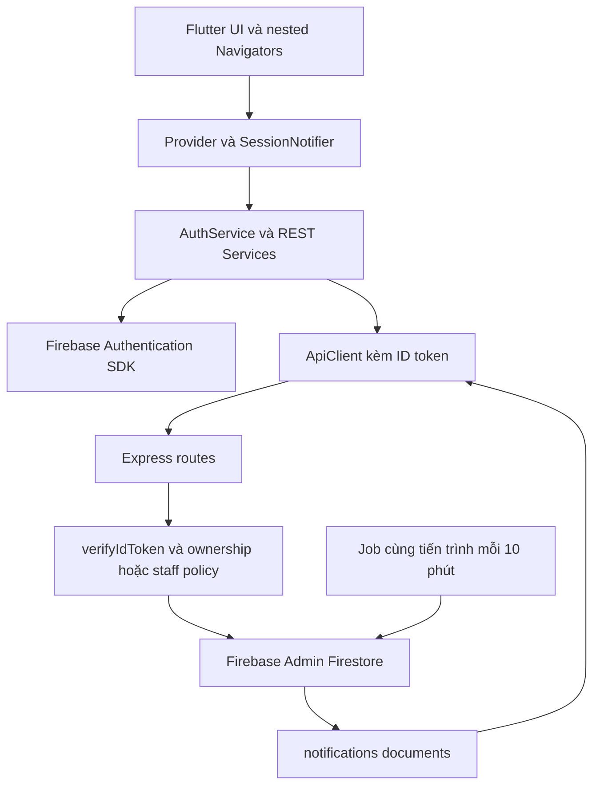

> Tài liệu lịch sử ngày 01/11/2026, không phải hướng dẫn hiện hành, xem [README.md](../../../README.md).

# Full application audit — MediCare Dental

Ngày: **01/11/2026**, Asia/Ho_Chi_Minh. Nguồn sự thật: mã trong workspace tại thời điểm audit. Không dùng Git để xác định revision. Báo cáo chỉ phản ánh snapshot này, bao gồm hai bản sửa lifecycle/serialization và test đã tồn tại từ các lượt trước yêu cầu audit.

## Executive summary

Ứng dụng có đường tích hợp Flutter → REST Express → Firebase Admin/Firestore thật trong source, với mock mode riêng. Booking, catalog, articles và thông báo in-app có implementation đáng kể cùng nhiều test fake thành công. **Chưa đủ điều kiện xác nhận toàn bộ nghiệp vụ hoặc demo Firebase E2E thành công.** Backend đang có lỗi/gap completion, ownership liên kết follow-up, archived history và reminder. Flutter analyze sạch không đồng nghĩa backend contract đúng.

Tổng cộng **18 phát hiện: 0 P0, 6 P1, 10 P2, 2 P3**; xem [issue register](AUDIT_ISSUE_REGISTER.md). Không suy diễn số test fail thành số bug. Một số fail là test lệch nhãn/contract; media suite hỏng harness, không chứng minh tất cả thao tác ảnh runtime hỏng.

10 ưu tiên: AUD-01 completion không ghi invoice/rx; AUD-02 ghi đè visit; AUD-03 follow-up thiếu validation quan hệ; AUD-04 stale backlink; AUD-05 reminder race; AUD-06 archived history; AUD-07 thiếu reminder 2h/tái khám; AUD-08 reminder stale; AUD-09 ngày/timezone; AUD-10 clinical payload validation.

## Phạm vi và nguyên tắc đã áp dụng

- Chỉ đọc source không nhạy cảm, chạy static analysis và test đã kiểm tra fake/mock, tạo bốn báo cáo yêu cầu. Không sửa source/test/dependency/Rules/schema/contract trong lượt audit.
- Không thực hiện lệnh Git, không mở .env/credential/private key, không gọi Firebase thật, không seed/migration/deploy hoặc request thay đổi dữ liệu thật.
- Không khởi động `src/server.js`, vì entrypoint sẽ nạp Firebase và chạy job ngay. Không chạy script seed/cleanup dù tồn tại trong backend/scripts.
- Test Express chỉ mở server loopback cổng ngẫu nhiên, config Firebase được thay trong require.cache bằng in-memory database trước khi import route. Đây là request có ghi **fake data**, không phải production/sandbox Firebase.
- Không đọc firebase_options.dart hoặc file cấu hình chứa giá trị kết nối; chỉ kiểm tra cách main.dart gọi initialization và các import. Không audit tính đúng của credential hay quyền IAM.
- Phạm vi là review các đường chạy chính và regression suites, không phải chứng minh hình thức mọi dòng code hay pentest. Không có kiểm thử trên thiết bị trong lượt audit này.

## Ý nghĩa trạng thái

| Trạng thái | Cách dùng trong báo cáo |
|---|---|
| VERIFIED | Bằng chứng source hoặc test mock/fake xác định; ghi rõ loại bằng chứng |
| PARTIALLY VERIFIED | Có code và một phần test, còn điều kiện/nhánh hoặc runtime chưa xác minh |
| NOT VERIFIED | Chưa có chứng cứ chạy cho điều kiện đó |
| BLOCKED | Cần Firebase/credential/hạ tầng hoặc harness chưa hoạt động, ngoài phạm vi cho phép |
| NOT IMPLEMENTED | Không có logic cần thiết trong đường chạy được khảo sát; không tự coi mọi gap là lỗi nghiêm trọng |

## Bản đồ kiến trúc

FCM/push hệ điều hành không có trong sơ đồ vì chưa có implementation. Worker schedule nằm trong RAM của process, **dữ liệu notification nằm trong Firestore**, không phải notification chỉ lưu RAM.

| Lớp | Entry/file quan trọng | Trách nhiệm và phụ thuộc |
|---|---|---|
| Bootstrap | frontend/lib/main.dart:21 | Firebase.initializeApp, FirebaseAuthService, restoreSession, providers, PrivateSession |
| Root navigation | frontend/lib/app.dart; routes/app_routes.dart | Chọn welcome/main theo auth, key App theo sessionGeneration |
| Tab/back | app/main_shell.dart; app/patient_navigation.dart | Home/Booking/Records/Me, nested navigation và pending BookingRequest |
| Session | app/private_session.dart; core/state/session_notifier.dart | Clear private stores đồng bộ khi UID/session đổi; reset booking request |
| Transport | data/api_client.dart; core/network/api_client.dart | getIdToken từng request, Bearer, timeout, phân loại lỗi HTTP/JSON |
| Config | core/config/app_config.dart | Default api; mock explicit; Android emulator 10.0.2.2:3000, nền tảng khác localhost:3000; API_BASE_URL/API_URL override |
| Backend | backend/src/server.js:1-59 | Express 5, CORS, parser, 20 route groups, 404/error handler; listen 3000 rồi start reminder |
| Auth | backend/src/middleware/auth.js; requireStaff.js | verifyIdToken, 401; verified claims cho staff/admin, 403 khi thiếu quyền |
| DB | backend/src/config/firebase.js qua imports | Firebase Admin initialization dùng file credential cục bộ; **không mở credential** |
| Background | backend/src/jobs/reminders.js | Chạy ngay và setInterval 10 phút; không distributed scheduler/leader lock/shutdown hook |

Legacy route `/users` và `/users/form` còn ở AppRoutes, nhưng MainShell không cung cấp menu quản lý user. Không suy ra đây là staff console. Không tìm thấy UI staff hoàn chỉnh trong frontend được khảo sát; staff APIs là phần backend. Không tự gán quyền staff để thử.

### Models/services và collection map

Frontend có UserProfile/FamilyMember, DentalService/Doctor, Appointment/AvailabilitySlot, Article/ContentHome/ContentNotification, Visit/Prescription/Receipt/TreatmentPlan/TreatmentSession/Followup. BookingService/AvailabilityService, ProfileService/CatalogService, RecordsService/MediaService và ContentService chuyển REST sang model. `data/api_client.dart` re-export transport chung, không phải hai stack auth độc lập.

Collection được source sử dụng: `users`, `users/<uid>/family_members`, `users/<uid>/favorites`, `services`, `combos`, `doctors`, `doctor_schedules`, `vouchers`, `appointments`, `appointment_slots`, `appointment_requests`, `visits`, `prescriptions`, `invoices`, `treatments`, `treatment_sessions`, `follow_ups`, `notifications`, `media`, `photos`, `treatment_photos`.

M1 cung cấp identity/patient/catalog cho cả 3 module khác. M2 tạo appointment, slot locks và event notifications; completion gọi utility M3; followUpId nối M3 trở lại M2. M3 cung cấp clinical data và sources cho deep links M4. M4 dùng appointment changes refresh Home/unread, catalog/favorites M1 và notification nguồn M2/M3. Thay contract completion/follow-up cần hai owner thống nhất trước.

## Module 1 — Bình

### Authentication và session

- VERIFIED source: FirebaseAuthService có signIn/register/signOut/reset/changePassword, reauthentication khi đổi mật khẩu, email verification; UserProvider và màn auth có loading/error, syncProfile gọi backend sau login/register. Mock tests xác minh message/state, không gửi email Firebase thật.
- VERIFIED source: ApiClient lấy ID token qua currentUser.getIdToken; middleware verifyIdToken trước route private; 401/403 được phân loại, server 5xx hiển thị generic. Không thấy client role/accountId được dùng để thay req.user trong guard.
- PARTIALLY VERIFIED: token hết hạn tự refresh dựa vào SDK; không có forced refresh + retry 401 hay global logout handler tại transport. Revoked/disabled-session behavior thật NOT VERIFIED; verifyIdToken không truyền tham số checkRevoked. Không tự gọi đây là bypass token.
- VERIFIED mock/source: PrivateSession clear profile, records, favorites, appointments, pending booking; App đổi key theo session; provider generations loại response cũ. ProfileProvider.clear tại :244 xóa MediaCache. ContentProvider setAccount reset các private states. Identity events thật khi đổi account chưa được chạy E2E.

### Profile/family/catalog/favorites

- VERIFIED source + mock: user route dùng req.user.uid, whitelist profile/health fields; family nằm dưới users/<uid>; soft archive kiểm tra lịch tương lai trong transaction. Favorites nằm dưới account, deterministic type_itemId; reject missing/inactive source khi thêm.
- VERIFIED source: catalog list lọc isActive false; detail vẫn trả inactive để xem lịch sử/favorites; booking validate lại service/doctor active và mapping. Không fallback mock tên/ID khi API lỗi ở các đường API được test.
- PARTIALLY VERIFIED: concurrency archive và booking có transaction guards; test fake không chứng minh toàn bộ Firestore isolation. Lịch sử archived thực tế không đáp ứng lời hứa giữ khả năng xem: AUD-06.
- Gap quyền staff/admin giữa route: AUD-14. Profile text/date validation dùng native Date và phone 9–11 số; frontend normalize +84 có mock tests, cần contract/edge dates kiểm chứng riêng.

## Module 2 — Phương

### Booking và lịch hẹn

- VERIFIED fake: chọn dịch vụ/combo, bác sĩ đủ serviceIds, availability theo ngày; tính quote server và revalidate voucher/giá/thời lượng trong transaction; giữ slot bucket 15 phút; tránh chồng giờ bác sĩ và bệnh nhân.
- VERIFIED fake: hai request cùng slot chỉ một thành công; voucher lượt cuối không dùng hai lần; idempotency replay cùng key; key khác nội dung trả 409; khóa bấm submit/draft và xử lý retry mạng có mock tests.
- VERIFIED source: POST appointments lấy accountId từ UID, patientId phải là self hoặc family active; không nhận giá chốt do client tự khai. Thời gian lưu theo date/startTime +07:00; giới hạn trong tương lai 30 ngày; hủy trước ít nhất 2 giờ; trả slot và voucher có transaction.
- VERIFIED source/fake: state machine booked → confirmed/rejected/cancelled; confirmed → completed/cancelled; requireStaff cho status; event notices có ID trạng thái cố định. Appointment list/get owner-scoped, staff list riêng.
- VERIFIED mock: AppointmentsProvider giữ create/cancel đã xác nhận khỏi list response cũ, refreshOne loại nguồn 403/404; generation chặn response account trước. UI không đảm bảo cập nhật tức thời khi staff đổi nếu không có một lần refresh; không có realtime listener/push.
- PARTIALLY VERIFIED: conservative lock15 có thể loại slot không thực sự overlap nếu duration/start không căn bucket; cần xác minh dữ liệu lịch thực tế trước coi là lỗi. VoucherRef fallback scan toàn bộ collection có chi phí; quote/availability public không có rate limit ở app.

### followUpId — trạng thái chính xác

| Điểm kiểm tra | Kết luận theo source hiện tại |
|---|---|
| Handoff Flutter | VERIFIED: FollowupScreen:112 → BookingRequest → BookingScreen:143 → controller.applyInitialValues |
| Giữ draft | VERIFIED mock/source: followUpId + followUpPatientId, activeFollowUpId chỉ gửi khi patient khớp; reset khi replaceSelection/session |
| Request/response/model | VERIFIED: BookingService.createAppointment gửi ID; backend lưu followUpId trong appointment, response spread data; Appointment model đọc ID |
| Fingerprint | VERIFIED fake: backend appointments.js:187-200 và controller fingerprint đều có followUpId; đổi ID cùng key trả 409 |
| Validation booking | Có kiểm tra tồn tại, accountId nếu field có giá trị, patientId, open status suggested/scheduled và serviceId nếu có; mọi kiểm tra nằm trong transaction |
| Thiếu validation | accountId không bắt buộc có; không kiểm source visit/treatment ở create/booking. Nguồn follow-up có thể đã sai từ AUD-03. Legacy policy cần duyệt, không tự sửa |
| Hai booking active | Normal flow bị chặn bằng read/update follow-up trong transaction; fake A08 pass. Firestore concurrency thực NOT VERIFIED; stale backlink có AUD-04 |
| Hủy/từ chối/complete | Có reopen/complete helper; normal fake flow pass, nhưng helper không so appointmentId nên ca stale fail |
| Appointment cũ không ID | null/absent đi qua nhánh bỏ linkage; booking/cancel/status tests legacy tiếp tục pass |

Không tuyên bố followUpId chưa có, cũng không coi liên kết này hoàn toàn an toàn cho mọi dữ liệu legacy.

## Module 3 — Ngân

- VERIFIED source + fake/mock: list records theo patient, detail theo ID, prescriptions theo visitId + patient match, treatment sessions/photos theo treatmentId + patient; RecordsService và PatientDataProvider tải API thật trong api mode. Date/model parser có xử lý missing/malformed và không tự dựng clinical 1970.
- VERIFIED source/fake: treatment create ghi treatment + sessions transaction; PATCH session và patient link-visit kiểm tra completed/cùng patient/không link trùng; link-visit fake có các ca concurrency/rollback/ownership thành công.
- PARTIALLY VERIFIED: staff completion tạo visit_<appointmentId>, update appointment.visitId và visit_result cùng transaction, nhưng thiếu invoice/rx (AUD-01), collision guard (AUD-02), validation clinical (AUD-10). Không có luồng tạo treatment tự động khi complete; treatment được tạo bằng API staff riêng, không coi việc tách bước này tự nó là bug.
- Follow-up được tạo bằng POST riêng, có event notification persisted nhưng validation nguồn thiếu (AUD-03) và ngày chưa chặt (AUD-09). Không phải completion tự sinh follow-up.
- Receipt UI đọc invoices qua model Receipt, không có payment gateway/thu tiền thật được xác minh. GET invoice đọc chứng từ tồn tại không chứng minh tạo hoặc thanh toán đã hoàn tất.
- Archived history AUD-06; N+1/partial error AUD-11. API-mode một lỗi detail có thể chặn toàn màn records; không fallback sang hồ sơ demo để che lỗi.
- Bản sửa serialization từ lượt trước đang có tại utils/records.js:10, hai test riêng pass. Lỗi đó không còn được tính là finding mở mới.

## Module 4 — Nhi

### Home/articles/UI

- VERIFIED source/fake: GET home auth, active featured services tối đa 6, doctors tối đa 6, published articles mới nhất 3, nearest future appointment của account kể cả người thân. Slice sau read toàn query; thiếu pagination không phải query limit thật.
- VERIFIED mock: article list/detail public API, 404/draft bị chặn; favorites chia sẻ catalog state; image error placeholder; không lấy bài mock khi API fail. ContentProvider _load coalesce jobs, session guards và notification revision bảo vệ response cũ.
- VERIFIED một phần UI bằng mock: card tap, Xem tất cả, carousel swipe/arrows, nested back, loading/empty/error và một số text-scale/small-screen tests. Chưa đánh giá screen reader trên thiết bị hoặc toàn bộ screen ở mọi font/locale. Ba test destination bị stale label chặn phần sau (AUD-17).
- Bản sửa dispose của màn thông báo đã có trước audit: scheduleMicrotask + session guard tại api_notifications_view.dart:71; regression test leaving notifications pass. Không có bằng chứng lỗi locked widget tree còn tái hiện trong các test đã chạy.

### Notifications và reminder

| Cơ chế | Trạng thái |
|---|---|
| A — Event notification | Có: booked/cancelled/confirmed/rejected/visit_result/follow_up ghi Firestore từ API |
| B — Scheduled in-app | Có một phần: appointments confirmed còn 0–24h, job mỗi 10 phút, persisted notification |
| C — OS push | NOT IMPLEMENTED trong source khảo sát: không firebase_messaging/getMessaging/device token/permission/send push |

VERIFIED fake: notification owner list/count/read/read-all; read idempotent, read-all chunks 450; phân nhóm UI all/appointment/offer/system, follow-up thuộc nhóm clinical/appointment. API notifications có thể mở appointment/visit/follow-up bằng refId, đọc lại nguồn và kiểm session; source 403/404 báo lỗi, không fallback mock. Offer/system có thể chỉ hiển thị/đọc nếu không có đích hỗ trợ; không suy ra mọi notification đều có deep link.

Worker được `server.js:58` start sau listen, chạy ngay rồi **10 phút**, không phải 5 phút. Mỗi process chạy một timer mặc định, gọi start nhiều lần tạo nhiều timer, request staff run-reminders có thể overlap. Không distributed lock, không unref/stop API/shutdown hook. Job có persistence chống tạo document mới sau restart nhờ deterministic ID, nhưng get/set không atomic, không phân biệt mốc nhắc, có race (AUD-05). Không có follow-up reminder, 2h reminder hay lịch 08:00 (AUD-07).

Preferences: PATCH users/me.notificationsEnabled persist boolean; mặc định true cho field thiếu; job đọc user mỗi appointment và skip khi false. Event notices không bị preference chặn. Preference không phải quyền notification hệ điều hành, không tắt notification đã tồn tại (AUD-08). Job không duyệt rebooked follow-up vì không có nhánh follow-up, nên không thể nói đã chống nhắc rebook.

Cancel/reject xóa ID reminder hiện tại trong transaction; completed không xóa. Đổi giờ không có API reschedule trong source khảo sát; nếu dữ liệu đổi ngoài flow, ID giờ cũ không được job dọn. List/count/read-all cùng scope owner nhưng không lọc reminder theo trạng thái nguồn.

## Backend/Firebase/security review

| Chủ đề | Đánh giá và giới hạn |
|---|---|
| Auth/RBAC | Middleware verify token, verified claims; account-scoped routes tốt ở nhiều flow; policy staff đọc clinical chưa đồng nhất (AUD-14) |
| Request input | Booking validation tương đối đầy đủ; completion/follow-up/date còn gap; IDs sai kiểu ở một số route có thể thành generic 500, chưa phân loại hết mọi endpoint |
| Transaction | Booking/locks/voucher/status/link-session có transaction; reminder không có; completion không read collision |
| Error/log | Generic 500 và malformed JSON/413 handler; console.error raw backend error. Không mở runtime log thật, chưa xác minh log redaction vận hành; test log chỉ fake |
| Query/cost | Nhiều get không limit, home slice client-side, records N+1; notifications read-all chia batch 450; không có pagination/cursor contract chung |
| Index | Có query date/doctor và range schedule, staff status+date; không tìm thấy rules/index manifest trong danh sách file khảo sát. Index đã provision trên Firebase NOT VERIFIED, không khẳng định query chắc chắn thiếu index |
| Rules/IAM | Không đọc/sửa Rules, không truy cập console. Admin SDK backend cần backend guards; tính đúng Rules/IAM triển khai BLOCKED |
| Middleware | CORS mở mặc định, JSON parser 1mb toàn app; chưa có rate limiter trong app. CORS không thay ownership/auth |
| TLS/deployment | Default emulator URL HTTP dùng dev; HTTPS/gateway/container/process replicas/monitoring NOT VERIFIED |
| Dependencies | Đọc package manifests và lockfile names; không install/update hoặc npm audit network. Không đưa kết luận CVE/version safety nếu chưa kiểm chứng advisory |
| Media | Base64 JPEG/PNG size max700KB, byte signature; saved media owner/staff guard; test suite backend chưa load được (AUD-13). Không xem ảnh bệnh nhân thật |

## Kiểm thử đã chạy và an toàn

Đã kiểm tra import/setup trước chạy: module2 scheduling/staff-status, module3 link-visit và module4 routes dùng require.cache fake trực tiếp; các suite khác dùng installFakeFirebase trước production import. `records-serialization.test.js` fake config riêng. Frontend test config chọn mock mặc định; API suites inject MockClient/fake services. Không chạy integration_test/device/live Firebase. Các Flutter widget test dùng test binding, không thực thi main() Firebase initialization.

| Lệnh, thư mục thực thi | Kết quả thực tế | Phạm vi |
|---|---|---|
| `node --test test/module2/*.test.cjs test/module3/*.test.cjs test/module4/*.test.cjs test/records-serialization.test.js` tại backend | **155 entries: 120 pass, 35 fail, 0 skip** | Fake Firestore/loopback; media file load failure được tính một entry fail |
| `flutter test --no-pub --reporter expanded` tại frontend | **308 pass, 3 fail, 132 skip** | Cấu hình mặc định test mock; một số test tự scope api với MockClient |
| `flutter test --no-pub --dart-define=DATA_SOURCE=api --reporter expanded` tại frontend | **426 pass, 3 fail, 14 skip** | API-mode với MockClient/fake; một số test tự scope mock |
| `flutter analyze --no-pub` tại frontend | **PASS — No issues found**, 4.0s | Static analysis, không chứng minh runtime/backend |

Logs tại máy audit: `/tmp/medicare-audit-backend.log`, `/tmp/medicare-audit-flutter-default.log`, `/tmp/medicare-audit-flutter-api.log`, `/tmp/medicare-audit-analyze.log`; đây là log tạm, không cần commit. Lệnh capture log dùng tail nên exit code shell cuối không dùng làm kết luận PASS: số pass/fail lấy từ output test runner.

Backend failures tập trung ở clinical completion/validation (thiếu chứng từ/staff metadata/collision guard), ngày/tạo follow-up, reminder contract/logic, media harness. Một số khác biệt là kỳ vọng response thống kê job (`appointmentReminders/...` so với `{created}`), status code 400/404 và ID reminder legacy; không tự tuyên bố chúng đều là lỗi nghiệp vụ mới. Frontend cả hai mode fail đúng ba ca width do label Thay ảnh (demo), không phải exception overflow được ghi nhận.

**SKIP an toàn:** không chạy npm test nguyên bản vì discovery bỏ `.cjs` và helper `booking-safeguards.test.js` import Firebase config thật; không chạy helper đó riêng, không chạy scripts seed/cleanup/server hoặc integration/device test chưa cô lập đầy đủ. Các skip đếm trong Flutter là điều kiện mode của suite hiện có, không phải 132/14 feature chưa triển khai. Không sửa test để đạt PASS.

## NOT VERIFIED / BLOCKED / NOT IMPLEMENTED

- BLOCKED theo phạm vi audit: Firebase E2E, auth email/password thật, token refresh/revocation thực, Firestore indexes/Rules/IAM/quota, notification persistence thực sau restart server, nhiều replica thật, quyền OS camera/gallery và trải nghiệm app đóng.
- NOT VERIFIED: lịch/demo data hiện có trên backend đang chạy; không gọi API thật kể cả read để tránh credential. Accessibility screen reader, thiết bị thật, mọi kích thước/text scale, HTTPS/proxy/rate limit ngoài repo, tải lớn/latency và dependency advisories.
- BLOCKED do harness: backend media suite không khởi tạo được; không lấy Flutter image tests làm bằng chứng thay thế toàn pipeline ảnh.
- NOT IMPLEMENTED: completion invoice/rx hiện tại, reminder follow-up, mốc nhắc riêng 2h, push FCM/device-token pipeline. Không tìm thấy staff app UI hoàn chỉnh, payment gateway trong frontend; cần xác nhận phạm vi sản phẩm trước coi là backlog bắt buộc.
- PARTIALLY VERIFIED: business E2E, lịch sử archived, source links legacy, patient/follow-up races, responsive suite bị dừng. Không có nhãn Firebase E2E PASS trong audit này.

## Phân công và thứ tự xử lý đề xuất — chưa thực hiện

1. Ngân + Phương cùng chốt completion contract và linkage invariants; Ngân xử lý AUD-01/02/03/09/10, Phương chịu caller/status/idempotency. Không đồng thời sửa cùng appointments.js mà chưa chia đoạn/PR.
2. Bình + Ngân thống nhất active-patient vs historical-access và RBAC (AUD-06/14). Giữ guard booking archived riêng; không mở quyền chung chỉ để test xanh.
3. Phương + Ngân sửa backlink stale AUD-04 trên contract đã thống nhất, giữ tương thích appointment không followUpId.
4. Nhi + Phương chốt reminder policy, giải AUD-05/07/08; mốc thời gian và event/in-app/push phải tách rõ. FCM là hạng mục mới cần phê duyệt, không hứa đã có.
5. Nhi điều phối AUD-11/12/13/17/18, mỗi owner sửa test/route thuộc module; Bình chủ trì auth/gateway policy. AUD-15/16 cập nhật sau khi behavior ổn định.
6. Chạy lại fake/mock suites, review source, sau đó nhóm tự duyệt kế hoạch test Firebase sandbox tách biệt. Chỉ khi đó mới có thể đánh giá E2E thật/demo toàn phần.

Các báo cáo đi kèm: [Issue register](AUDIT_ISSUE_REGISTER.md), [E2E flow](END_TO_END_FLOW_AUDIT.md), [Demo checklist](DEMO_READINESS_CHECKLIST.md).
